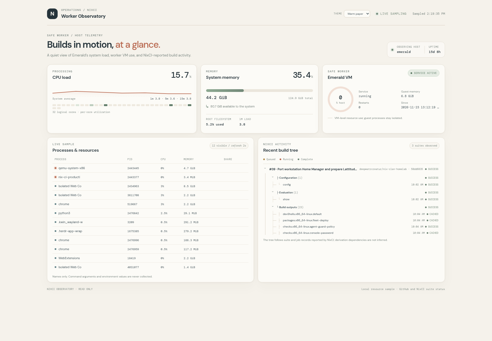

# nixci-observatory

A live, read-only operations view for a self-hosted NixCI worker. It brings
together host load, the safe worker VM's resource use, and recent NixCI suites
without claiming that a particular worker ran a suite unless NixCI exposes
that attribution.



Captured on Emerald while its safe worker service was active. The suites in
the screenshot are recent public status records; NixCI does not identify which
worker handled them, so they are not evidence that this worker has taken a
job.

The layout borrows the useful parts of `btop` and `nh`: compact resource
panels, small live graphs, and an expandable suite-to-job tree. It uses a warm
light palette and keeps process arguments out of the process table.

## Run

```sh
nix run
```

Open <http://127.0.0.1:8092>. The app binds to loopback by default. To view it
from another machine, tunnel the port over SSH rather than exposing it to the
LAN:

```sh
ssh -L 8092:127.0.0.1:8092 emerald
```

## Configuration

| Variable | Default | Purpose |
| --- | --- | --- |
| `NIXCI_OBSERVATORY_HOST` | `127.0.0.1` | HTTP bind address |
| `NIXCI_OBSERVATORY_PORT` | `8092` | HTTP port |
| `NIXCI_OBSERVATORY_WORKER_UNIT` | `nix-ci-production-worker-emerald-worker-1.service` | Local safe worker unit to observe |
| `NIXCI_OBSERVATORY_REPOSITORIES` | `deepwatrcreatur/nix-clan-homelab,deepwatrcreatur/unified-nix-configuration` | GitHub repositories whose NixCI suites appear in the activity view |
| `NIXCI_OBSERVATORY_REFRESH_SECONDS` | `45` | Minimum interval between GitHub and NixCI API refreshes |

The GitHub repositories and NixCI suite pages must be readable without
authentication. An optional `GH_TOKEN` can raise GitHub's API rate limit; the
app never sends it to NixCI. Do not expose this server publicly: its host
metrics and repository activity are intended for the operator.

The resource sampler reads `/proc`, the worker service's systemd properties,
and its cgroup counters. The process table shows process names only, never
command-line arguments. Suite status and job names come from GitHub commit
statuses and NixCI's public suite pages. The tree represents NixCI-reported
jobs; it does not infer derivation dependencies.

## Screenshots

Screenshots live under [`docs/screenshots/`](docs/screenshots/). They show the
dashboard layout and live data at capture time; host metrics and suite status
will change as the system runs.
