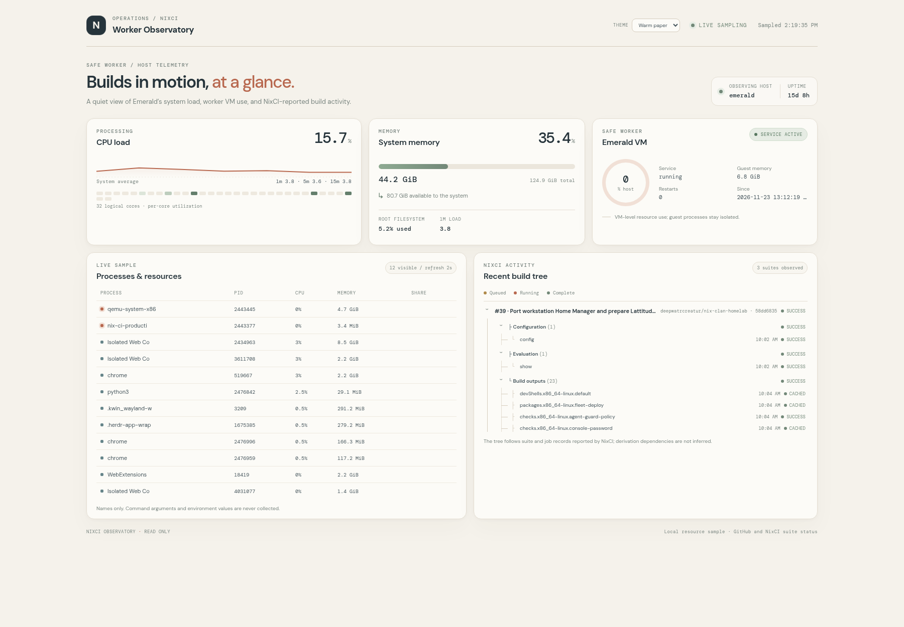

# NixCI Observatory: owner brief

This is a read-only operator dashboard. It shows Emerald's host load, the safe worker VM's CPU and memory use, and NixCI's suite status in separate panels. The worker service was active when this screenshot was taken; the page does not claim that a specific build ran on Emerald.

That distinction is deliberate: NixCI's public suite status does not identify which worker handled a job, and VM CPU activity only proves that the VM used resources. Our test submission for `nix-clan-homelab` returned HTTP 402 before a job started, so we do not yet have an end-to-end Emerald build to show.

To make attribution reliable, the worker would need to expose a stable job/attempt ID, worker and VM identity, slot, start and terminal events, timestamps, and outcome. The dashboard could match those events to NixCI's result and measure the VM's CPU, memory, and I/O during that attempt. Could NixCI provide a supported local event feed or hook and a safe way to export it from the worker VM? We have not enabled debug SSH, changed the worker configuration, or forked the code.

The [design discussions](./discussions/README.md) record the evidence, alternatives, and conditions under which a private fork might be considered.
